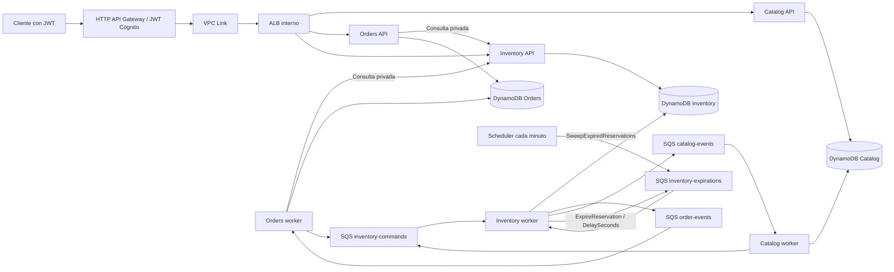

# Ticketing infrastructure

Repositorio independiente de infraestructura para los servicios **catalog**, **orders** e **inventory**. Implementa Terraform modular para DEV, QA y PROD; consume las tres imágenes aprobadas del repositorio de aplicaciones por digest. Cada microservicio tiene dos despliegues independientes, API y worker, con la misma imagen y tabla propietaria. No contiene código de negocio ni reconstruye sus contenedores.

El entorno local de la aplicación usa un emulador compatible con SQS. Esta infraestructura crea **colas reales Amazon SQS Standard** cuando un operador autoriza un despliegue. Las pruebas locales de Terraform usan un provider simulado: no acreditan un despliegue AWS, permisos efectivos, rendimiento cloud ni compatibilidad completa del emulador.

## Estructura

- `infra/bootstrap`: estado S3/KMS, tres repositorios ECR y roles GitHub OIDC separados para plan y apply.
- `infra/modules`: network, data, messaging, identity-ingress, service, observability y composición platform.
- `infra/envs/{dev,qa,prod}`: raíces aisladas, backends independientes y políticas fijas por entorno.
- `scripts`: instalación verificable de herramientas, auditoría por commit y pruebas de esa auditoría.
- `.github/workflows`: calidad sin credenciales y planificación AWS manual con rol de lectura.

## Herramientas fijadas

| Herramienta | Versión |
|---|---|
| Terraform | 1.17.2 |
| AWS provider | 6.73.0, con lockfiles versionados |
| TFLint | 0.66.0 |
| Checkov | 3.4.5 |
| Gitleaks | 8.30.1 |

Los instaladores CI verifican SHA-256 contra los archivos oficiales de cada release. Terraform verifica los paquetes del provider mediante sus checksums. No se usa `latest` para imágenes ni herramientas.

## Verificación local sin AWS

```sh
terraform fmt -check -recursive infra
tflint --recursive --config="$PWD/.tflint.hcl"
checkov --directory . --config-file .checkov.yml
gitleaks dir --redact --no-banner .
python scripts/test_verify.py

for root in infra/bootstrap infra/envs/dev infra/envs/qa infra/envs/prod; do
  terraform -chdir="$root" init -backend=false -input=false -lockfile=readonly
  terraform -chdir="$root" validate
  terraform -chdir="$root" test
done
```

`terraform test` contiene únicamente `command = plan` y providers AWS simulados. No utiliza credenciales, no aplica infraestructura ni modifica cuentas AWS. `init` descarga el provider oficial; no accede a AWS con `-backend=false`.

Las pruebas verifican las cuentas/roles esperados, rechazo de imágenes mutables y callbacks HTTP, tareas privadas/no root, límites de escalado, ausencia de Scan/permisos SQS amplios, confianza OIDC exacta, límites de tamaño IAM y protección del estado ante el rol de plan.

## Arquitectura



Tres microservicios generan seis ECS services, seis task definitions y seis task roles: API/worker por contexto. Solo las APIs se registran en ALB y Cloud Map. Los workers sirven health en localhost:8080, sin ingreso de red, y escalan por backlog SQS; las APIs escalan por CPU. Los workers ejecutan outbox y consumidores. Cuatro colas principales tienen cuatro DLQ de consumo; Scheduler tiene una quinta DLQ para fallos de entrega. Las tareas no tienen IP pública ni NAT. DynamoDB/S3 usan gateway endpoints; SQS/ECR API/ECR DKR/Logs usan interface endpoints en dos zonas. Ninguna imagen debe instalar dependencias al iniciar.

La disponibilidad y asignación de entradas siguen siendo responsabilidad de la aplicación. Terraform no sustituye las transacciones condicionales ni proporciona entrega exactly-once.

## Próximos pasos operativos

1. Revisar [ambientes y despliegue](docs/deployment.md), con entradas obligatorias de cuenta, identidad, presupuesto y digests.
2. Configurar [contrato de aplicación e identidad](docs/application-contract.md).
3. Revisar [seguridad y excepciones](docs/security.md) y [runbooks](docs/operations.md).
4. Configurar la política confiable del pipeline antes del primer push protegido.

No hay workflow de apply automático. Los planes autenticados se mantienen sensibles y no se publican como artifacts generales. El procedimiento de despliegue requiere autorización concreta de cuenta, ventana y presupuesto.
